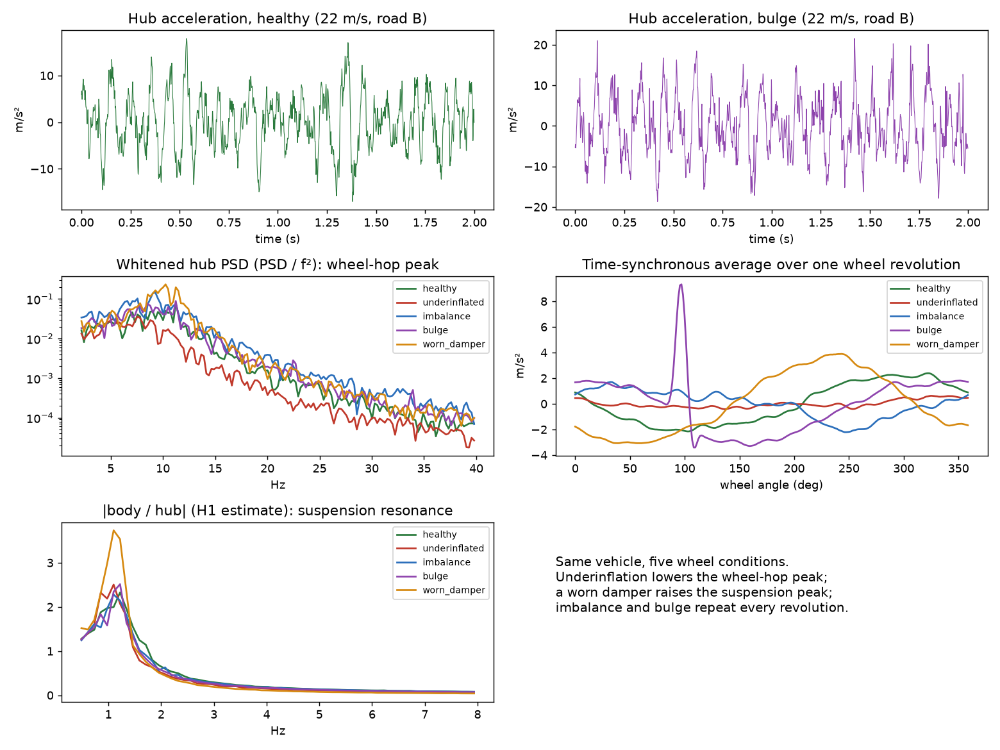
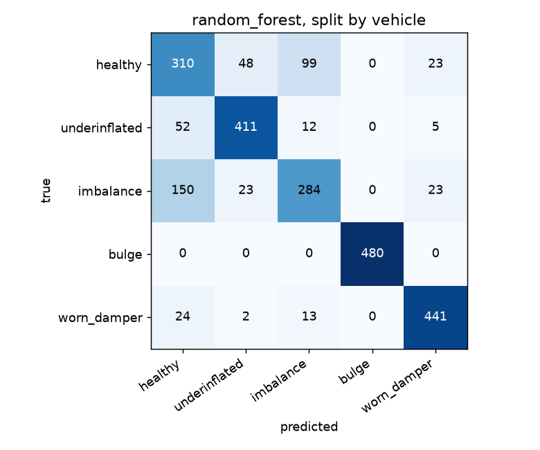
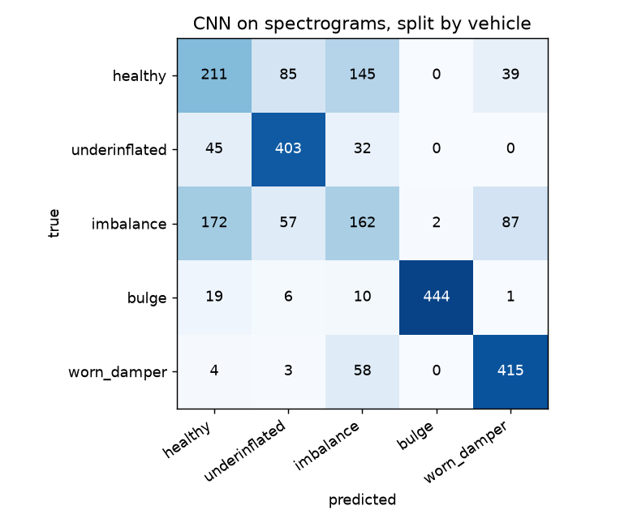
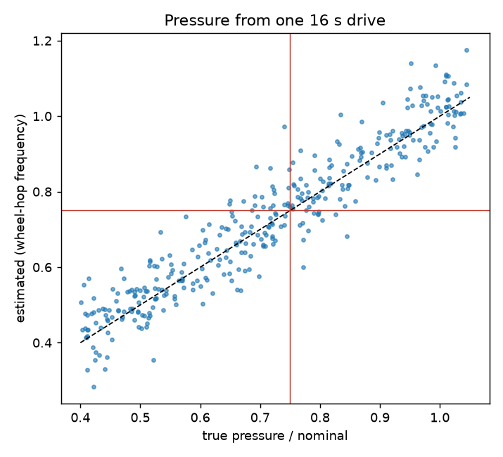
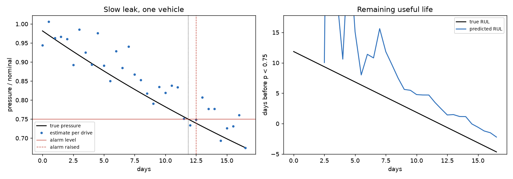

# tire-vibration-predictive-maintenance

**Status: research prototype on simulated data.** Predictive maintenance of a car wheel from vibration. It detects and identifies wheel faults, estimates tyre pressure without a pressure sensor, and predicts how many days remain before a slow leak makes a tyre underinflated.



## Background

This started as a summer internship project in 2024 at Smart Automation Technologies. The subject was *predictive maintenance of tyres based on sound analysis*: generate data, train a model that predicts a failure, and compare two approaches, analysing the signal itself or analysing its spectrogram as an image. Two pairs of students worked on it. My original files were lost, so this repository is a **reimplementation from scratch**.

What remained of the 2024 work was a report with its MATLAB and Python listings and three CSV files. `tire_pdm/baseline2024.py` ports that pipeline to Python and regenerates the 2024 CSV files exactly. Running it showed three problems:

- **One curve per tyre condition.** The data held one normal, one flat and one punctured curve. Every training row was a point of one of those curves, not a tyre.
- **The original classifier learned nothing.** The linear SVC scores 63.8 % on a random split of those points, exactly the share of "fault" rows. It predicts "fault" for everything.
- **No sound.** Despite the title, all the data were computed vibration responses.

The physical idea was sound: a tyre that loses pressure becomes a softer spring, so the wheel resonates at a lower frequency. This project keeps that idea and rebuilds the data and the evaluation around it.

## How it works

```
quarter-car model + ISO 8608 road + wheel faults
                   │  160 simulated vehicles × 5 conditions × 3 drives
                   ▼
   hub and body accelerations (16 s, 1 kHz), wheel speed (ABS)
                   │
                   ▼
            30 signal-processing features
                   │
   ┌───────────────┼───────────────────┬───────────────────────┐
   ▼               ▼                   ▼                       ▼
fault          anomaly detection   pressure estimate   ──►  slow-leak prognostics
classification (healthy data only) (wheel-hop frequency)    (remaining useful life)
```

**Simulator** (`physics.py`, `scenarios.py`)
- **Quarter-car model**: two masses. The body sits on the suspension, and the wheel sits on the tyre, which acts as a spring.
- **Road**: profiles drawn from the ISO 8608 spectra, classes A to C.
- **Variability**: every vehicle has its own masses, stiffnesses and damping. Every drive has its own speed (43–108 km/h), road and load, plus sensor noise and calibration error.
- **Healthy tyres are not perfect**: they keep a small residual imbalance, some run-out and a pressure between 92 and 105 % of nominal.
- **Five conditions**:
  - healthy;
  - underinflated (45–75 % of nominal pressure);
  - wheel imbalance (40–120 g at the rim);
  - tyre bulge (1.5–4 mm, one shock per revolution);
  - worn damper (25–55 % of nominal damping).

The time simulation matches the analytic frequency response within 1 %, and the road profiles match the ISO 8608 spectra. Both are checked by tests.

**Features** (`features.py`), each tied to a mechanism:
- **Wheel-hop frequency and damping**: a 1-DOF resonance is fitted on the hub PSD divided by f². Bins at the wheel orders are excluded, since faults put lines there.
- **Suspension resonance and damping ratio**: from the body/hub transfer (H1 estimator). It depends only on the suspension, not on the road or the tyre.
- **Wheel orders and time-synchronous averaging**: the signal is averaged over about 150 revolutions, using the ABS wheel speed. The random road averages out, and whatever repeats every turn remains (imbalance, bulge).
- **Global statistics**: RMS, kurtosis, crest factor, relative band energies.

**Models**

| Task | File | Method |
|---|---|---|
| Fault classification | `models.py` | SVC, random forest, gradient boosting |
| Spectrogram approach | `cnn.py` | small CNN on the hub log-spectrogram, with no hand-made feature and no wheel speed |
| Anomaly detection | `models.py` | Mahalanobis distance and Isolation Forest, trained on healthy drives only. The alarm threshold is set out-of-sample for 5 % false alarms |
| Pressure estimation | `itpms.py` | relative drop of the wheel-hop frequency against the vehicle's own healthy reference, turned into a pressure ratio by the tyre model (the principle of indirect TPMS) |
| Prognostics | `itpms.py` | slow leak with exponential pressure decay, one drive every 12 h. A robust exponential trend predicts when the pressure will cross 75 % of nominal |

**Evaluation.** Every evaluation splits by vehicle (5-fold `GroupKFold`): the test vehicles are never seen in training.

## Installation

```bash
pip install -e ".[test]"          # simulator, features, classical models
pip install -e ".[test,cnn]"      # + PyTorch for the spectrogram CNN
```

## Usage

```bash
pytest                            # 12 tests, about 10 s
python scripts/run_all.py         # every experiment, about 17 min on a laptop CPU
python scripts/run_all.py --no-cnn
```

`run_all.py` writes `results/results.json`, the figures in `figures/` and the generated dataset in `data/` (not versioned). All random draws use fixed seeds.

```python
import numpy as np
from tire_pdm.scenarios import sample_vehicle, sample_condition, simulate_run
from tire_pdm.features import extract

rng = np.random.default_rng(0)
car = sample_vehicle(rng)
run = simulate_run(car, sample_condition("underinflated", rng), rng)
feats = extract(run.body_acc, run.hub_acc, run.fs, run.speed, run.wheel_rot_hz)
print(feats["hop_freq"], run.car.natural_frequencies()[1])   # estimated vs true wheel-hop frequency
```

## Results

These numbers come from the run committed in `results/results.json`: Windows 10, Python 3.11, CPU only, 17 minutes. They are measured on **simulated** data, on vehicles never seen in training.

### Fault classification (5 classes, 2,400 drives, 160 vehicles)

| Method | Accuracy | Macro-F1 |
|---|---|---|
| Random forest, all features | **80.3 %** | 0.80 |
| Gradient boosting, all features | 79.7 % | 0.80 |
| SVC (RBF), all features | 79.4 % | 0.79 |
| SVC (RBF), band energies and RMS only | 70.5 % | 0.70 |
| CNN on spectrograms | 68.1 % | 0.67 |

Recall per class:

| Condition | Random forest | CNN |
|---|---|---|
| bulge | 100 % | 93 % |
| worn damper | 92 % | 86 % |
| underinflated | 86 % | 84 % |
| healthy | 65 % | 44 % |
| imbalance | 59 % | 34 % |

What the classification results show:
- The physics-based features add about 10 points over plain band energies.
- The image approach loses mainly on imbalance. Imbalance shows up only at the wheel rotation frequency, which the CNN does not know.
- The hardest pair is healthy versus imbalance: 40–120 g is small next to the road excitation.
- A random split mixing vehicles gives 80.9 %, close to the 80.3 % of the vehicle split.

<p>


</p>

### Anomaly detection, trained on healthy drives only

| | Mahalanobis | Isolation Forest |
|---|---|---|
| False alarms on healthy drives | 4.6 % | 5.4 % |
| Detected: bulge | 100 % | 87 % |
| Detected: worn damper | 66 % | 80 % |
| Detected: underinflated | 58 % | 47 % |
| Detected: imbalance | 26 % | 18 % |

### Pressure estimation (360 drives, true pressure 40–105 % of nominal)

| | |
|---|---|
| Mean absolute error | 0.049 (pressure ratio) |
| 90th percentile of the absolute error | 0.101 |
| Tyres below 75 % flagged from one drive | 89 % |
| False alarms for tyres above 90 % | 0 % |

The estimated wheel-hop frequency correlates with the true one at 0.978. The suspension damping ratio is recovered with a 1.5 % median error.



### Slow-leak prognostics (40 vehicles)

- An alarm is raised for 38 of the 40 vehicles.
- The median alarm time is 0.7 day after the true crossing of 75 % (10th–90th percentile: −1.2 to +2.6 days).
- Median error of the predicted remaining useful life:

| Prediction made at | True RUL (median) | Error (median) |
|---|---|---|
| 25 % of the leak | 8.2 days | 3.6 days |
| 50 % of the leak | 5.5 days | 1.6 days |
| 75 % of the leak | 2.7 days | 1.0 day |



## Tests

```bash
pytest
```

12 tests pass locally (Windows 10, Python 3.11). They cover:
- the time simulation against the analytic frequency response, at 1.2, 5, 11 and 30 Hz;
- the natural frequencies against closed-form limits;
- the road PSD against ISO 8608;
- the 2024 port against the values of the original CSV files;
- the recovery of the wheel-hop frequency and of the suspension damping;
- the response of the synchronous features to a bulge and to an imbalance;
- the pressure inversion and the decay fit;
- the absence of ground-truth columns among the model inputs.

CI runs the tests on Python 3.10–3.12. It does not run the CNN or the full experiment.

## Limitations

- **Simulated data only.** The results show that the method works inside this simulator. They say nothing yet about a real car, with cornering, braking, real roads and temperature.
- **Simple model.** The model covers vertical motion only, on a quarter car. The tyre is a linear spring and damper, and its stiffness is assumed linear in pressure with a 25 % carcass share. All parameter ranges are plausible assumptions, not measurements.
- **The pressure estimate needs a healthy reference per vehicle** and assumes a nominal suspension-to-tyre stiffness ratio.
- **The prognostics assume a regular leak.** A sudden puncture cannot be predicted.
- **Still no sound.** The sensors are accelerometers. Airborne sound would need real recordings.
- **Only lightly tuned.** The CNN is small and trained for 25 epochs. A larger network, or one that also gets the wheel speed, might close part of the gap.

## License

MIT, see [LICENSE](LICENSE).
